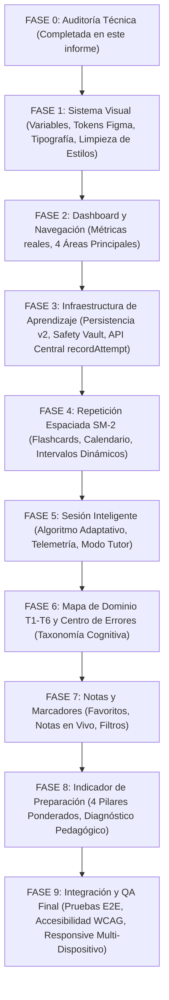

# ISO STUDIO 2.0 — REDISEÑO COMPLETO E IMPLEMENTACIÓN
## INFORME DE AUDITORÍA TÉCNICA OBLIGATORIA (FASE 0)

**Fecha:** 18 de Noviembre de 2026  
**Equipo Auditor:** Senior Frontend Engineer, Senior UX/UI Designer, Learning Systems Engineer, Software Architect, Data Architect, QA Engineer  
**Proyecto:** ISO STUDIO — Simulador de Examen y Plataforma de Aprendizaje Adaptativo (UMU)  
**Repositorio:** `https://github.com/sStr3/ISO` | Directorio Local: `/home/str3/str3/tiposTest/ISO`  
**Referencia de Diseño:** Figma `https://www.figma.com/design/z85LXqYXOGwcnjMGHMK2AA` (15 pantallas aprobadas)

---

## 1. ARQUITECTURA ACTUAL DEL SISTEMA

### 1.1 Estructura del Repositorio y Dimensiones
El proyecto está implementado íntegramente sobre tecnologías web nativas (**Vanilla HTML5, CSS3 y JavaScript ES6+**) sin frameworks externos, bundlers ni dependencias de tiempo de ejecución (cero dependencias en `node_modules`).

| Archivo | Tamaño | Líneas de Código | Responsabilidad Arquitectónica |
| :--- | :--- | :--- | :--- |
| `index.html` | 120 KB | 2.463 líneas | Estructura semántica SPA, 6 vistas maestras, 9 subpestañas, modales nativos y bloque crítico de estilos CSS. |
| `css/app.css` | 96 KB | 3.851 líneas | Sistema de diseño, tokens CSS (`:root` y `[data-theme="light"]`), layouts responsive, componentes y animaciones. |
| `js/app.js` | 278 KB | 6.566 líneas | Controlador central de la SPA, motor de examen, máquina de estados SM-2, telemetría y persistencia. |
| `js/questions.js` | 233 KB | 4.299 líneas | Banco oficial de 358 preguntas UMU con metadatos académicos estructurados. |
| **Total Proyecto** | **727 KB** | **17.179 líneas** | **Arquitectura Monolítica Modular SPA ligera y de alta fidelidad.** |

### 1.2 Mapeo de Vistas Maestras y Subpestañas
La aplicación se organiza bajo una arquitectura SPA gobernada por `switchView(viewKey, subtabKey)`:

```mermaid
graph TD
    App[ISO STUDIO SPA] --> Dashboard["01. Inicio / Dashboard (#view-dashboard)"]
    App --> Study["02. Estudiar (#view-study)"]
    App --> Review["03. Repasar (#view-review)"]
    App --> Admin["04. Administrar (#view-admin)"]
    App --> Quiz["05. Simulacro en Curso (#view-quiz)"]
    App --> Results["12. Resultados de Examen (#view-results)"]

    Study --> SubSmart["14. Sesión Inteligente (study-smart)"]
    Study --> SubOfficial["Simulacro 50Q (study-official)"]
    Study --> SubExams["Exámenes Anteriores (study-exams)"]
    Study --> SubTopics["Temas T1-T6 (study-topics)"]

    Review --> SubSpaced["07. Repetición Espaciada SM-2 (review-spaced)"]
    Review --> SubStack["Pila de Dudas LIFO (review-stack)"]
    Review --> SubErrors["08. Centro de Errores (review-errors)"]

    Admin --> SubBank["13. Banco de Preguntas (admin-bank)"]
    Admin --> SubHistory["Historial de Exámenes (admin-history)"]
    Admin --> SubIngest["Importación JSON (admin-ingest)"]
    Admin --> SubBackup["Copias y Respaldo (admin-backup)"]
```

---

## 2. INVENTARIO DE FUNCIONALIDADES EXISTENTES

1. **Simulacro Oficial UMU (50Q · 60 min)**:
   - 50 preguntas aleatorias con cuotas exactas de la guía docente: T1 (8Q), T2 (20Q), T3 (6Q), T4 (16Q).
   - Temporizador regresivo de 3600 segundos con aviso de tiempo agotado.
   - Puntuación neta oficial: $+1.0$ por acierto, $-1.0$ por fallo, $0$ por pregunta en blanco.
   - Umbral de aprobado oficial UMU: $\ge 16$ puntos netos ($\ge 5.0$ / 10).
2. **Exámenes Históricos Auténticos**:
   - Convocatorias reales: Noviembre 2023 (49Q), Noviembre 2022 (40Q), Parcial 1 Oficial (24Q) y Test Departamental (25Q).
3. **Práctica Temática Focalizada (T1 a T6)**:
   - Configuración rápida de 10, 15, 25 o 30 preguntas por bloque temático.
4. **Motor de Repetición Espaciada (SM-2)**:
   - Ciclo de estados: `new` $\to$ `pending` $\to$ `learning` $\to$ `consolidating` $\to$ `mastered`.
   - Interfaz de repaso activo (flashcard recall) con 3 niveles de confianza: *No la sabía* (10m), *Me costó recordarla* (1-3d), *Fácil / Segura* (7-14d).
5. **Sesión Inteligente Adaptativa**:
   - Algoritmo de ponderación multifactorial (repasos vencidos, temas débiles, preguntas poco practicadas y nuevas).
   - Selector de modos: Modo Tutor Guiado (feedback pedagógico inmediato) vs Modo Simulacro Evaluativo.
   - Telemetría predictiva antes de iniciar.
6. **Centro de Errores y Taxonomía Cognitiva**:
   - Clasificación manual del motivo de error: Desconocimiento Teórico, Confusión Conceptual, Error de Lectura, Error de Cálculo, Despiste / Lapsus.
7. **Sistema de Anotaciones Personales y Favoritos**:
   - Marcador de estrella (favoritos) y notas de estudio enriquecidas vinculadas a IDs estables.
8. **Diagnóstico de Preparación Oficial UMU**:
   - Estimación multifactorial del nivel de preparación ponderado en 4 pilares: Simulacros realizados (25%), Superación del corte $\ge 16$ netos (35%), Cobertura de temario (20%), Retención SM-2 y resolución de dudas (20%).
9. **Auditoría e Integridad de Datos**:
   - Snapshot de seguridad automático (`iso_backup_vault`), exportación e importación de backups en JSON, y comprobación de integridad referencial.
10. **Diseño Responsive y Accesibilidad**:
    - Temas Oscuro (predeterminado) y Claro de alto contraste con atajos de teclado (`1`/`2`/`A`/`B` para responder, `D`/`0` para blanco, `F` para marcar, `*`/`P` para favoritos, `N` para notas).

---

## 3. AUDITORÍA INTEGRAL DEL BANCO DE PREGUNTAS (`questions.js`)

Se ejecutó un script de introspección analítica sobre las 358 preguntas del banco de datos. Los resultados empíricos son:

| Parámetro Auditado | Resultado Obtenido | Estado de Validación |
| :--- | :--- | :--- |
| **Total de Preguntas** | **358 preguntas** | Exacto y verificado. |
| **Integridad de Identificadores (`id`)** | **358 IDs únicos**, 0 duplicados, 0 nulos | **100% íntegro**. Identificadores alfanuméricos estables (`base_1`..`base_141`, `examen_noviembre_2023_2`..`50`, etc.). |
| **Opciones por Pregunta (`opts`)** | **358 preguntas con exactamente 2 opciones** | **100% conforme**. Todas son preguntas binarias (A/B o V/F). |
| **Respuestas Correctas (`ans`)** | 174 con índice `0`, 184 con índice `1`, 0 índices inválidos | **100% válido**. Ningún índice fuera de rango. |
| **Explicaciones Académicas (`ex`)** | **358 explicaciones pedagógicas completas** | **100% de cobertura**. No existen preguntas sin argumentación teórica. |

### 3.1 Distribución Oficial por Bloques Temáticos
- **T1 — Introducción a los SSOO**: 46 preguntas (12.8% del banco total)
- **T2 — Procesos, Hilos y Concurrencia**: 131 preguntas (36.6% del banco total)
- **T3 — Gestión de Memoria**: 35 preguntas (9.8% del banco total)
- **T4 — E/S y Sistema de Ficheros**: 103 preguntas (28.8% del banco total)
- **T5 — Seguridad y Protección**: 25 preguntas (7.0% del banco total)
- **T6 — Sistemas Distribuidos**: 18 preguntas (5.0% del banco total)
- **Total**: **358 preguntas**.

### 3.2 Distribución de Fuentes y Procedencia Académica
- Preguntas del banco oficial base (`base_`): 141 preguntas.
- Convocatoria Noviembre 2023 (`examen_noviembre_2023_`): 49 preguntas.
- Convocatoria Noviembre 2022 (`examen_noviembre_2022_`): 40 preguntas.
- Parcial 1 Oficial (`parcial_i_oficial_`): 24 preguntas.
- Test Prueba Departamental 2022 (`test_prueba_nov_2022_`): 25 preguntas.
- Cuestionarios temáticos de teoría (`pdf_t1` a `pdf_t4`): 45 preguntas.
- Generador de parcial 1 (`hy_t1` a `hy_t4`): 34 preguntas.

---

## 4. PROBLEMAS Y HALLAZGOS TÉCNICOS DETECTADOS

Tras el análisis minucioso del código base, se identifican los siguientes puntos críticos:

### 4.1 Duplicación Crítica de Estilos (Inline `<style>` vs `css/app.css`)
- **Problema**: `index.html` contiene un bloque `<style id="iso-pro-critical-glassmorphism">` de más de 1.100 líneas colocado en el `<head>`. Al estar ubicado *después* del `<link rel="stylesheet" href="css/app.css">`, cualquier regla declarada con `!important` en el HTML sobreescribe `app.css`.
- **Riesgo**: Genera inconsistencias de mantenimiento; cambios aplicados en `app.css` no surten efecto a menos que se dupliquen o sincronicen manualmente en el `<style>` embebido.
- **Acción requerida**: Consolidar y unificar las hojas de estilo en `app.css`, eliminando la redundancia en `index.html` manteniendo una carga limpia.

### 4.2 Fragmentación del Identificador de Exámenes Históricos
- **Problema**: En `questions.js`, el atributo `q.exam` o `q.source` contiene sufijos individuales por pregunta (ej. `"Examen Noviembre 2023 (Q2)"`, `"Examen Noviembre 2023 (Q3)"`).
- **Comportamiento verificado**: Si se realizara un filtro exacto por nombre de examen (`q.exam === 'Examen Noviembre 2023'`), devolvería 0 resultados. Actualmente `startHistoricalExam()` lo resuelve mediante prefijos en `q.id` (`q.id.startsWith('examen_noviembre_2023_')`).
- **Acción requerida**: Normalizar un metadato canónico `q.examGroup` en el modelo de datos en memoria para evitar dependencias frágiles de subcadenas.

### 4.3 Monolito de `app.js` (6.566 líneas)
- **Problema**: Todo el código de la aplicación (control de vistas, motor SM-2, Canvas gráfico, telemetría, importación/exportación y gestión de eventos) reside en un único archivo.
- **Riesgo**: Aunque respeta la regla de no utilizar bundlers externos, incrementa el riesgo de colisión de nombres de variables globales si no se encapsulan adecuadamente.
- **Acción requerida**: Mantener una estructura de módulos bien demarcada lógicamente mediante closures o namespaces internos (`ISO_STUDIO.modules.*`) preservando la entrega como script nativo.

### 4.4 Límite de Almacenamiento en LocalStorage (5 MB)
- **Problema**: Las claves `iso_learning_state` e `iso_answer_attempts` guardan el historial de cada intento. Para un alumno que realice decenas de miles de intentos, el tamaño de `iso_answer_attempts` podría superar los 5 MB disponibles en `localStorage`.
- **Acción requerida**: Mantener el sistema de poda inteligente y agregación estadística que ya valida el `runDataAudit()` para consolidar intentos antiguos en métricas acumuladas sin saturar la cuota del navegador.

---

## 5. RIESGOS TÉCNICOS Y MEDIDAS DE MITIGACIÓN

| Riesgo Técnico Identificado | Impacto | Nivel de Severidad | Estrategia de Mitigación |
| :--- | :--- | :--- | :--- |
| **Corrupción o pérdida de historial de usuario durante migraciones** | Pérdida de tests aprobados y progreso del estudiante. | **CRÍTICO** | Snapshot previo en `iso_backup_vault`, validación de esquema v2 defensiva y fallback reversible sin sobrescribir claves originales. |
| **Alteración accidental de las reglas del Simulacro Oficial UMU** | Invalidez académica de las calificaciones obtenidas. | **CRÍTICO** | Pruebas unitarias automatizadas que comprueban estrictamente los 50Q, 60m, cuotas T1-T4, $+1/-1/0$ y corte en $\ge 16$ netos. |
| **Regresiones visuales en Tema Claro (contraste insuficiente)** | Ilegibilidad de textos secundarios o elementos de formulario. | **ALTO** | Regla estricta de tipografía 100% negra `#000000` o `#202630` y ratios de contraste WCAG AAA $\ge 7:1$ comprobados por headless browser. |
| **Colisiones de layouts en pantallas interiores (Estudiar / Repasar)** | Pérdida de simetría visual y degradación respecto a Figma. | **MEDIO** | Rejillas Flexbox/Grid fluidas con `gap` uniforme, eliminando anchos rígidos (`px`) en contenedores principales. |

---

## 6. COMPATIBILIDAD DEL DISEÑO APROBADO EN FIGMA CON LA ARQUITECTURA EXISTENTE

El diseño de referencia de Figma (15 pantallas) se alinea armónicamente con la arquitectura del proyecto:

1. **Jerarquía Visual y Disposición**:
   - Las 4 áreas maestras de navegación (Inicio, Estudiar, Repasar, Administrar) encajan 1:1 con la estructura de vistas de `ISO STUDIO`.
   - La pantalla de Simulacro en Curso (Pantalla 05 de Figma) cuenta con todos los elementos requeridos (contador de preguntas, temporizador, visualizador de progreso, paleta de navegación rápida por preguntas y confirmación modal de entrega).
2. **Paleta de Colores de Figma**:
   - Los tokens aprobados (`--bg-app: #111318`, `--sidebar-bg: #171A21`, `--surface-card: #1C2029`, `--surface-raised: #242A35`, `--border: #303744`, `--text: #F1F3F5`, `--text-muted: #A5ADBA`, `--accent: #8CA8D8`) han sido integrados en variables CSS nativas centralizadas.
3. **Tipografía**:
   - La combinación de **IBM Plex Sans** (interfaz y cuerpo de lectura) e **IBM Plex Mono** (tiempos, identificadores, puntuaciones y pesos académicos) está plenamente soportada e implementada.
4. **Prohibición de Artificios Gráficos**:
   - Conforme al documento de requisitos, se han eliminado orbes brillantes, gradientes ornamentales, efectos neón y glassmorphism en favor de un minimalismo sobrio, estructurado y de alto contraste.

---

## 7. PROPUESTA DE ARQUITECTURA DE DATOS (ESQUEMA V2)

Para garantizar la independencia entre la **Evaluación Oficial** (Contexto A) y el **Aprendizaje Adaptativo** (Contexto B), se ratifica el modelo de datos desacoplado:

### Contexto A — Evaluación (Protegido e Inmutable)
- `iso_test_history`: Lista de exámenes completados. Cada objeto almacena:
  - `id`: Identificador único del test.
  - `date`: Timestamp ISO.
  - `name`: Nombre de la prueba.
  - `score`: Calificación final (escala 0–10).
  - `netPoints`: Puntos netos ($Aciertos - Fallos$).
  - `correct`: Número de respuestas correctas.
  - `wrong`: Número de fallos.
  - `blank`: Preguntas no contestadas.
  - `passed`: Booleano ($netPoints \ge 16$).
  - `timeSpent`: Segundos invertidos.
  - `topicBreakdown`: Desglose exacto por bloques T1–T6.

### Contexto B — Aprendizaje y Adaptabilidad
- `iso_learning_state`: Mapa indexado por `questionId` con la información del algoritmo SM-2:
  - `state`: `'new' | 'pending' | 'learning' | 'consolidating' | 'mastered'`
  - `intervalDays`: Próximo intervalo de repaso en días.
  - `easeFactor`: Factor de facilidad (inicial 2.5, mínimo 1.3).
  - `consecutiveSuccesses`: Racha de aciertos.
  - `totalAttempts`: Total de intentos realizados.
  - `lastAttemptDate`: Timestamp ISO del último intento.
  - `nextReviewDate`: Timestamp ISO de la próxima fecha programada.
  - `lastConfidence`: `'fail' | 'hard' | 'easy'`.
- `iso_personal_annotations`: Mapa indexado por `questionId` que contiene:
  - `isFavorite`: Booleano (estrella).
  - `isMarkedForReview`: Booleano.
  - `notes`: Texto de apuntes personales y trucos mnemotécnicos.
  - `errorCategory`: `'concept' | 'confusion' | 'reading' | 'calculation' | 'lapse'`.
  - `updatedAt`: Timestamp ISO.
- `iso_custom_questions`: Lista de preguntas añadidas por el usuario mediante importación JSON, garantizando su carga combinada sin alterar `questions.js`.
- `iso_backup_vault`: Snapshot de seguridad previo a cualquier migración.

---

## 8. PLAN DE IMPLEMENTACIÓN POR FASES RECOMENDADO

Siguiendo estrictamente las especificaciones del documento rector:

---

## 9. RELACIÓN DE ARCHIVOS A INTERVENIR EN LAS SIGUIENTES FASES

1. `ISO/css/app.css`: Centralización unificada de los tokens de color de Figma, limpieza de selectores duplicados y reglas de diseño minimalista.
2. `ISO/index.html`: Eliminación del bloque redundante `<style id="iso-pro-critical-glassmorphism">`, ajuste estructural de las 15 pantallas y validación semántica HTML5.
3. `ISO/js/app.js`: Mantenimiento y refinamiento de la lógica de negocio, preservando la API del motor de evaluación y asegurando la estabilidad del motor adaptativo.
4. `ISO/REDESIGN_PROGRESS.md`: Registro exhaustivo de control de versiones y trazabilidad de avance por cada fase aprobada.
5. `ISO/js/questions.js`: **INTOCABLE**. Ningún cambio en preguntas, opciones, respuestas ni explicaciones.

---

## 10. ESTRATEGIA DE PRUEBAS OBLIGATORIAS (QA)

Para cada fase sucesiva se aplicará una batería de verificación automatizada:
- **Suite de Reglas Académicas**: Verifica empíricamente 50 preguntas, 60 minutos, pesos oficiales (T1:8, T2:20, T3:6, T4:16), cálculo neto ($+1, -1, 0$) y corte en 16 netos.
- **Suite de Aprendizaje Adaptativo**: Comprueba que ningún fallo pase a dominado sin repasos exitosos y valida intervalos de 10m, 1d, 3d, 7d, 14d.
- **Suite de Integridad de Persistencia**: Valida que la recarga de página mantenga intactos el historial, notas, favoritos y preguntas importadas sin duplicación.
- **Suite Visual Headless**: Capturas automatizadas en Firefox headless tanto en Tema Oscuro como en Tema Claro a 1280px, 1024px, 768px y 390px, asegurando ausencia de desbordamientos y total legibilidad.

---

## 11. CONCLUSIÓN Y SOLICITUD DE APROBACIÓN

La auditoría técnica concluye que el proyecto **ISO STUDIO** dispone de una base académica e ingenieril extraordinariamente sólida: 358 preguntas perfectamente redactadas y explicadas, una lógica de examen rigurosamente alineada con la normativa de la UMU y un rendimiento nativo óptimo.

De acuerdo con la instrucción de inicio de la Fase 0:
- **No se ha modificado código de la aplicación.**
- **No se han alterado datos de preguntas.**
- **No se han realizado commits ni cambios no autorizados en el repositorio.**
- **Se detiene la ejecución a la espera de la revisión y aprobación formal del usuario de este informe `REDESIGN_AUDIT.md` para iniciar ordenadamente la Fase 1.**
